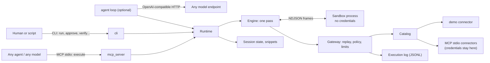

# Design: triage, analysis, design brief

This document is the output of phases 1 to 3 of the build brief. It was written
before any code. Source keys used throughout:

| Key | Source |
|---|---|
| CC | Claude Code docs, "Code Mode" — https://code.claude.com/docs/en/code-mode |
| CF | Cloudflare Agents docs, "Code Mode" (overview, how-it-works, API reference) — https://developers.cloudflare.com/agents/tools/codemode/ |
| CL | "Using a chaos loop to harden the Claude Docs launch" — https://claude.dev/blog/chaos-loop-claude-docs-launch/ |
| VER | "How the Claude Code team thinks about verification" — https://claude.dev/blog/how-the-claude-code-team-thinks-about-verification/ |
| MA | "Safely scaling multi-agent teams with Claude Fable 5.2" — https://claude.dev/blog/safely-scaling-multi-agent-teams-with-fable-5-2/ |
| UH | The Unharnessed repository (README, `unharnessed-runtime/src/rlm`, `crates/uh-core`, `skills/`, `scripts/`) |

A note on inputs: the brief distinguishes "articles" from "vendor docs". The six
inputs arrived as one list labelled articles, so all six are treated as
articles. Four of them (CC, CL, VER, MA) are published by one model vendor;
wherever they describe that vendor's product, only the vendor-neutral mechanism
is kept. No separate docs set was provided and none was needed.

---

## Phase 1 — Triage

Question asked of each input: does it change how an agentic, model-agnostic
application should be designed, built, or operated in code mode?

1. **CC — Claude Code "Code Mode" docs** → **RELEVANT.** It defines the
   pattern from the harness side: one program instead of many tool calls, the
   final expression is the result, inner calls are still permission-checked
   under their own tool names, and there are hard time limits. Everything about
   enabling it in that one product (env var, plan requirements, supported
   models, hook payload shapes) is product-specific and is not used.
2. **CF — Cloudflare "Code Mode" docs** → **RELEVANT.** The most complete
   architecture of the six: a single outer tool, typed declarations generated
   from JSON Schema, progressive discovery, a stateless pluggable executor, a
   host-side bridge where approval and logging apply, deterministic replay,
   limits, snippets. The Workers-specific machinery (Dynamic Worker Loader,
   Durable Objects, Workers RPC) is one implementation of those ideas and is
   not used.
3. **CL — Chaos loop post** → **RELEVANT, narrowly.** It is a launch
   retrospective with promotional framing, and it says nothing about running
   model-written code. What transfers is operational: write the invariants down
   first, make every operation measurable, inject faults on purpose, gate the
   hard-to-undo decisions, keep the dependency surface small enough to read.
   Its headline numbers are single-source and are not relied on.
4. **VER — Verification post** → **RELEVANT.** It shapes how the application
   is checked and how the application itself gates work: end-to-end runs over
   unit-test green checks, property and differential tests, a verifier the
   change cannot edit, provenance stamps that include "none", observe before
   enforce, escalate after bounded retries.
5. **MA — Multi-agent safety post** → **RELEVANT.** Under the theorem-proving
   story is a concrete safety architecture for agents that run code: a
   credential-free sandbox whose only way out is a gateway, identity stamped by
   the gateway, per-request limits, fail-closed checks, run records kept
   outside the sandbox, a verifier as the acceptance gate. The team structure,
   the Lean specifics and the throughput claims are not used.
6. **UH — Unharnessed** → **RELEVANT, and the sharpest critique of the other
   five.** It takes code mode to its limit (one tool, a persistent REPL, state
   in variables, helpers instead of tools, MCP reached from code, no permission
   prompts) and it is explicit about what that costs. It also supplies the
   wire-level craft: an NDJSON protocol whose framing user output cannot
   corrupt, exactly one terminal event per request, a scripted provider for
   deterministic end-to-end tests.

All six are relevant. None is set aside. One (CL) contributes only to how the
application is operated and tested, not to what it is.

---

## Phase 2 — Analysis

### Per-source thesis and principles

**CC — Claude Code "Code Mode"**

- A model that writes one program can run calls in parallel, pipe one result
  into the next call, and hand back only what matters.
- The value of the final expression is what the model reads.
- The code is not trusted as a unit: every inner call is checked against the
  deny and ask rules of the tool it invokes.
- A classifier that reviews the code block cannot see run-time values, so
  block-level review is weaker than call-level rules.
- Foreground code is time-boxed; isolating the code itself needs a container
  or VM.

Principles: one program per step (P1); final expression is the result (P2);
parallel and chained calls (P5); per-call policy under the tool's own name,
deny before ask (P7); wall-clock cap (P12); refusing one call need not kill
the program (P7); real isolation is an OS concern (P6); stoppable (P25).

**CF — Cloudflare "Code Mode"**

- One outer tool taking `{code}`; the description names the connector
  namespaces, not every method.
- Methods are found at run time with search and describe; declarations are
  generated from JSON Schema and degrade to "unknown" rather than fail.
- The executor runs one block once and keeps nothing; it has no credentials
  and no network; tool calls cross a bridge the host controls.
- Approval pauses the execution; resuming re-runs the same code and replays
  recorded results by sequence number; a mismatch is a hard error.
- Failures are data in a status union; limits are explicit numbers.

Principles: P1, P2, P3, P4, P6, P7, P8, P9, P10, P12, P13, P15, P22.

**CL — Chaos loop**

- A loop of "break it, measure it, fix it, re-run" hardens a system only if
  the system is legible: per-operation telemetry, few dependencies.
- Invariants are written before the loop starts and re-checked every
  iteration.
- Decisions that are hard to undo stop and wait for a human, with a
  recommendation attached.
- A first hypothesis is often wrong; measurement, not reasoning, settles it.

Principles: P8, P10, P19, P20, P21.

**VER — Verification**

- Verification loops are what make delegation scale; the evidence that counts
  comes from running the real system.
- Property tests and differential tests find the cases the author's own
  reasoning would not.
- The check must live where the change cannot touch it.
- Stamp how each unit of work was verified, including "none"; roll a gate out
  in observe mode before enforcing it.
- After a bounded number of failed rounds, stop and escalate.

Principles: P16, P17, P18, P19, P26.

**MA — Multi-agent safety**

- No single layer contains an agent; stack independent ones.
- The sandbox holds no credentials and has one outbound path, the gateway.
- The gateway, not the agent, attaches identity to each request.
- Shared resources get per-request time and size limits.
- Acceptance is decided by a checker, and run records live outside the
  sandbox.

Principles: P6, P7, P10, P11, P12, P13, P17.

**UH — Unharnessed**

- Every hardcoded tool is a decision made in advance for the model; give it
  one tool and let it write the rest.
- What the model reads should land in a named variable; only what it prints
  reaches the context.
- Helpers the model writes are functions it keeps and calls again.
- MCP tool schemas never enter the context: search, describe, call, from
  code.
- The harness is honest about its limits: the kernel is not a sandbox, so run
  it in a container.

Principles: P1, P2, P3, P5, P12, P13, P14, P15, P16, P22, P23, P24, P25, P26.

### Master Principle List

| # | Principle | Sources |
|---|---|---|
| P1 | The model gets one outer tool and writes a program; tools are an API called from code, not a list of round trips. | CC, CF, UH |
| P2 | Only the final value reaches the model. Intermediate results stay in the runtime; anything returned is budgeted and truncation is marked, never silent. | CC, CF, UH |
| P3 | Tool schemas are discovered at run time (search, then describe, then call), never preloaded into the context. | CF, UH |
| P4 | Callable signatures are generated from JSON Schema; an unsupported schema degrades to "any", it does not fail. | CF |
| P5 | One program can chain calls and run independent calls in parallel. | CC, UH |
| P6 | Generated code runs in a separate executor with no credentials. The executor is a pluggable interface. A process is not a security boundary; real isolation is a container or VM, and the docs say so. | CF, CC, MA, UH |
| P7 | Every tool call crosses a host-side gateway and is judged there under the tool's own name: deny, then ask, then allow. A refused call fails that call, not the program. | CC, CF, MA |
| P8 | Actions that are hard to undo wait for a human. Approval happens outside the agent's reach; rejecting does not undo what already ran. | CF, CL, MA, CC |
| P9 | Executions are durable and resumable by deterministic replay: every host interaction has a sequence number, a resumed pass replays recorded results, divergence is a hard error, nondeterminism goes through `step()`. | CF |
| P10 | An append-only log outside the sandbox records every call with per-operation telemetry (name, decision, duration, bytes). | CF, MA, UH, CL |
| P11 | Identity is stamped by the gateway, never claimed by sandbox code. | MA |
| P12 | Everything is bounded and the bounds are explicit: wall clock per execution, time per call, number of calls, size per value, size of output. | CC, CF, MA, UH |
| P13 | Fail closed, and report failure as data: an unmatched call is not executed by default; every execution has exactly one terminal outcome in a small status union. | MA, CF, UH |
| P14 | State lives in the runtime, not in the context: named values persist across executions. | UH |
| P15 | Code is reusable: a helper can be kept and called again. Promoting code for reuse is a host action on a completed execution, not something the model does to itself. | UH, CF |
| P16 | Verify by running the real thing end to end, keep a replayable trace, and stamp each unit of work with how it was verified, including "none". | VER, UH |
| P17 | What gates the work is out of reach of the work: sandbox code has no tool that edits policy, approvals or records. | VER, MA |
| P18 | A gate can run in observe mode (log what it would have done) before it enforces. | VER |
| P19 | Invariants are written down first and checked on every run; property and differential tests back them (replay must equal the original). | CL, VER |
| P20 | Faults are injected on purpose: kill the sandbox, stall a tool, flood the output, corrupt the protocol. | CL |
| P21 | Keep the system legible: few dependencies, behaviour traceable to the project's own code. | CL, UH |
| P22 | The static tool description is small; everything else is discovered. | UH, CF |
| P23 | User output cannot corrupt protocol framing; logs travel on their own channel. | UH |
| P24 | The model layer is provider-neutral and has a scripted stand-in for deterministic tests. | UH |
| P25 | A running execution can be stopped. | UH, CC |
| P26 | Bounded attempts, then hand back to a human instead of looping. | VER, UH |

### Contradictions and how they are resolved

| # | Conflict | Followed | Dropped, and why |
|---|---|---|---|
| C1 | UH never asks before running anything; CC, CF, CL and MA all gate risky actions. | Gating (P7, P8), but non-blocking in UH's spirit: an "ask" pauses the execution durably instead of holding a turn open. `policy.default` can be set to `allow` to make UH's bet explicitly. | "Never ask" as the default. Four sources against one, and UH itself calls it the riskier choice today. |
| C2 | CF's executor keeps no state; UH's whole point is a kernel that persists. | CF for the process (replay and container executors need a disposable one); UH for the principle, through an explicit `state` dict that persists per session (P14). | Live objects and running processes surviving between executions. They cannot be replayed or moved into a container. Deferred. |
| C3 | CC and UH want parallel calls; CF warns that free-running promises reorder calls and break replay. | Both: `parallel([...])` is one host-side operation whose sequence numbers come from list order, so calls run concurrently and replay stays deterministic (P5 with P9). | Free-form async code in the sandbox. |
| C4 | UH: the model should write its own capabilities, not just call a list the harness built. CF: reusable code is promoted by the application, never by the model. | Inside one execution the code is unrestricted Python. Reuse across executions goes through host-side snippet promotion (P15), because of P17. | Model self-promotion of code. |
| C5 | UH has no sub-agents on purpose; MA runs a thousand agents. | Neither position is built in. The runtime orchestrates nothing; it is safe to share because of P10, P11 and per-execution isolation. | Multi-agent orchestration (out of scope). |
| C6 | CC and CF run JavaScript; UH runs Python. | Python: standard library only, one command to run, and it is the language Unharnessed's kernel runs. The executor protocol is NDJSON, so a runner in another language is an addition, not a rewrite. | JavaScript as the sandbox language. |
| C7 | CC's auto mode has a model classify each code block; MA layers model-based monitors. CC also notes a block-level classifier cannot see run-time values. | Deterministic per-call rules. | A model-based classifier: it would add a model dependency to the safety path. The audit log is the hook for one. Deferred. |
| C8 | CC allows background code for up to two hours and UH has background commands with wake-ups; CF caps a pass at 60 s. | Bounded foreground execution, 60 s by default and configurable. | Background execution and wake-ups. Deferred. |

### Gaps no source covers, and the defaults that fill them

- **CLI contract for agents.** Fixed exit codes (0 ok, 1 failed, 2 usage,
  3 paused, 4 verification mismatch, 5 not found) and `--json` on every
  command.
- **Configuration format.** One JSON file, validated strictly, unknown keys
  rejected with the list of valid ones. Secrets are referenced as `${ENV}` and
  resolved on the host.
- **Stable fingerprints for replay.** SHA-256 over canonical JSON (sorted
  keys, compact separators, ASCII, no NaN).
- **Cross-platform process control.** Process groups on POSIX, `taskkill /T`
  on Windows; all pipes binary and ASCII-framed so console encodings do not
  matter.
- **Crash consistency.** A write-ahead `executing` entry precedes every live
  tool call, so the log never lacks a side effect that happened.
- **Concurrent approval.** A lock file per execution; a second pass is refused
  rather than risking a double side effect.
- **Exposing the runtime itself.** A stdio MCP server with one tool,
  `execute`, written against the public spec with the standard library.

---

## Phase 3 — Design brief

### What the application is

**codemode-runtime** is a portable code-mode gateway. It takes any set of
tools (MCP servers, or built-in connectors), turns them into a small typed
Python API, and gives any agent exactly one capability: `execute(code)`. The
program runs in a separate, credential-free process. Every tool call it makes
crosses a gateway on the host, where a deny/ask/allow policy, limits, identity
stamping and an append-only audit log apply. A call that needs approval pauses
the execution; after a human approves, the same code is re-run and recorded
results are replayed, so nothing runs twice. Only the final value and a bounded
slice of logs go back to the model. It is the pattern CC and CF describe, with
the safety boundary MA describes, the state and discovery ideas UH adds, and
the verification discipline VER and CL ask for. Nothing in it depends on a
model or a vendor.

### Architecture



Components, one responsibility each:

| Module | Responsibility |
|---|---|
| `config.py` | Load and validate the config; resolve `${ENV}` on the host. |
| `policy.py` | Pure: path to decision (deny, ask, allow, default). |
| `schema_sig.py` | Pure: JSON Schema to a Python-style signature. |
| `truncate.py` | Pure: output budgets with explicit markers. |
| `catalog.py` | Tool index: sanitized names, search, describe, resolve. |
| `connectors/` | `demo` (notes store), `chaos` (fault injection), `mcp_stdio` (any MCP server). |
| `executor.py` | The executor interface and the subprocess implementation. |
| `sandbox_runner.py` | The child side: the API the model's code sees. |
| `engine.py` | One pass: bridges child requests through the gateway. |
| `records.py` | Append-only JSONL execution log and its derived view. |
| `sessions.py` | Session state and snippets on disk. |
| `runtime.py` | The public API: execute, approve, reject, get, verify. |
| `mcp_server.py` | Stdio MCP server exposing one tool. |
| `llm_agent.py` | Optional loop against any OpenAI-compatible endpoint. |
| `cli.py`, `demo.py` | Commands, exit codes, the zero-config demo. |

One pass, in order:

1. The engine starts the executor and sends the runner, then the code, the
   session state and the namespace list.
2. The child runs the code. Each `tools.x.y()`, `parallel`, `search`,
   `describe`, `step` or `run` becomes a frame to the host and gets the next
   sequence number.
3. For each frame the gateway checks the log first. A recorded outcome is
   returned as is (after a fingerprint check). Otherwise the call is live:
   resolve the tool, apply limits, decide by policy, write the `executing`
   intent, call the connector, record the outcome.
4. An unapproved "ask" records a pending action and ends the pass as `paused`.
5. On `done` the result is hashed and recorded, the state delta is merged into
   the session, and the payload is budgeted and returned.

Data model (all under the data directory, `.codemode/` by default):

- `executions/<id>.jsonl` — one entry per line:
  `start` (code, hash, session, agent, state in, limits, policy hash),
  `call` (seq, kind, name, args, fingerprint, decision, state, result or
  error, duration, bytes), `approval`, `pass_end`, `end` (status, result,
  hash, state delta), `verify`.
- `sessions/<name>.json` — the `state` dict.
- `snippets/<name>.json` — promoted code and its source execution.

What the model's code sees:

```python
tools.<connector>.<tool>(**args)      # a call; returns a plain Python value
call("connector.tool", {...})         # the same, by path
parallel([("a.b", {...}), ...])       # concurrent, deterministic order
search("words"), describe("a.b")      # discovery
state["name"] = value                 # persists across executions
step("name", fn)                      # record a nondeterministic value
run("snippet", **args)                # reuse promoted code
# the last expression is the result; print() goes to the logs
```

### How it satisfies code mode

- **Use.** An agent connects over MCP and sees one tool, or shells out to
  `python main.py run --json`. The tool description is a few hundred words;
  the rest is found with `search` and `describe` from inside the code.
- **Run.** `python main.py` runs a demo with no configuration, no network and
  no model. `python main.py serve` is the MCP server.
- **Extend.** A new capability is an MCP server in the config, which needs no
  code change, or a connector class with two methods. A different sandbox is
  one line of config (`executor.command`), because the child protocol is
  frames on stdin and stdout.
- **Debug.** Every execution is a JSONL file; `show` prints it, `verify`
  replays it without touching any tool, and errors carry a type, a message and
  a hint. Exit codes say which of the six outcomes happened.

### Principle traceability matrix

| Principle | Design decision |
|---|---|
| P1 | The MCP server lists one tool, `execute`; the agent loop offers one function. |
| P2 | Trailing expression is the result; `truncate.py` budgets result and logs and marks what was cut; `stats` reports bytes that stayed in the sandbox. |
| P3 | `search` and `describe` are sandbox functions backed by `catalog.py`; schemas are never in the tool description. |
| P4 | `schema_sig.signature()`; anything it cannot type becomes `Any`. |
| P5 | Chaining is plain Python; `parallel()` runs a batch on host threads. |
| P6 | `executor.py` defines the interface; the default child gets a scrubbed environment and an empty working directory; `executor.command` wraps it in any container tool; the README states the limit of process isolation. |
| P7 | `engine.py` routes every call through `policy.decide()` on the sanitized path; a denied call raises `ToolError` in the code. |
| P8 | "ask" ends the pass as `paused`; `approve` and `reject` exist only on the CLI, never as sandbox functions or MCP tools. |
| P9 | Sequence numbers and fingerprints in `engine.py`; `ReplayDivergence`; `step()`. |
| P10 | `records.py`; each `call` entry has decision, state, duration and byte counts. |
| P11 | The agent name comes from `--agent` or the host environment and is written by the host into `start`. |
| P12 | `limits` in the config: `timeout_s`, `call_timeout_s`, `max_calls`, `max_value_bytes`, `max_result_chars`, `max_log_chars`, `max_state_bytes`. |
| P13 | `policy.default` is `ask` when unset; payload status is `completed`, `paused` or `error`; one `end` entry per execution. |
| P14 | `state` dict, persisted by `sessions.py` as a key-level delta on completion. |
| P15 | Helpers are ordinary functions within an execution; `snippet save` promotes a completed execution; `run()` calls it. |
| P16 | `tests/e2e.py` drives the real CLI and writes a command-and-output trace; `verify` stamps a record; unverified records say `none`. |
| P17 | No sandbox function or MCP tool touches policy, approvals or records. |
| P18 | `policy.mode` is `enforce` or `observe`. |
| P19 | Invariants I1 to I9 in `tests/FAILURE_MODES.md`, asserted by the end-to-end suite; a seeded property test checks replay equals original. |
| P20 | The `chaos` connector and the fault scenarios in the end-to-end suite. |
| P21 | Standard library only; an empty `requirements.txt`. |
| P22 | `Runtime.tool_description()` lists namespaces and the seven sandbox functions, nothing else; `python main.py prompt` prints it. |
| P23 | The child moves the protocol to private descriptors and points fd 1 at stderr before running any code. |
| P24 | `llm_agent.py` reads base URL, model and key from config or environment; the test suite drives it with a scripted stub endpoint. |
| P25 | A cancel event kills the child; the MCP server maps `notifications/cancelled` to it. |
| P26 | The agent loop stops at `--max-turns` with a non-zero exit instead of continuing. |

Deferred, with reasons, are listed in the verification report.

---

## After the first field report

Everything above was written before the code. This section was written after
five rounds of use in a real project, triaged in
[`FEEDBACK_TRIAGE.md`](FEEDBACK_TRIAGE.md). It records what the report
changed in the design, and what it did not.

### Principles the report added

| # | Principle | Where it comes from | Design decision |
|---|---|---|---|
| P27 | Work that finished before a failure is recoverable, without the program having planned for it. | A 40-minute run lost to one timeout. | A failed program's top-level variables are kept in the log and shown as shapes; `--reuse` runs a corrected program against the earlier log; a program cut off by its time limit gets a moment to return. |
| P28 | A caller with a short command timeout can start, ask about, wait for and stop an execution in separate commands, and "running" means a process is running it. | The top complaint in four rounds. | `run --detach`, `wait`, `cancel`; progress derived from the log; an execution whose process died is recorded as `Interrupted` by whoever looks next. |
| P29 | A hint is a command or a call the reader can make as it stands. | An approve hint that lost `--home`; hints that said `python`. | `launcher.py` rebuilds the command line of the running process; over MCP, hints name the tool call instead. |
| P30 | Anything that was cut says so, with the real size and a way to the rest. | A listing that stopped at ten; counts taken from a capped list. | Search totals, result shapes with `--select`, saved oversize results, marked command output. This sharpens P2. |
| P31 | A project adopts on its own: one command to set up, one to check, and its own code and commands without a fork. | The brief for this round. | `init`, `doctor`; the `commands` connector; the helpers folder, run in the sandbox. |
| P32 | A tool source is assumed to misbehave: slow, serial, noisy, crashing, oversized, leaking. | The servers the suite now runs against. | Per-connector and per-tool time limits, `max_concurrency`, restart on exit, schema shortening, removal of echoed credentials. This extends P20 from the sandbox to the connectors. |

### Earlier decisions revisited

| Decision | Then | Now, and why |
|---|---|---|
| C8: background execution | Dropped: a pass is foreground and bounded. | A pass is still bounded by `timeout_s`, but it can run in a worker process that outlives the command that started it. The limit of "foreground" turned out to be the caller's shell, not the runtime. Wake-ups are still not built: the caller asks. |
| C2: state lives in a session dict, saved on completion | Kept. | Unchanged, on purpose. Saving `state` from a failed program was considered and rejected: a program that adds to a counter and then fails would add again when retried. What a failed program held is kept separately (P27), where nothing reads it by accident. |
| P8, P17: approval is out of the agent's reach | "There is no approve tool." | That was not enough for an agent that drives the CLI through a shell: it could run `approve` itself. The command now needs a terminal on stdin unless the project's config says otherwise. This is a guard against the easy path, not a boundary: a process running as the same user can still edit the log (see the limit stated under P6). |
| P7: the policy sees the tool's name | The sanitized name. | Both spellings, the program's and the server's: a deny rule copied from a server's documentation must not silently miss. Rules can also look at arguments. Deny beats an approval. |
| MCP over HTTP | Deferred: one tested transport. | Built, both transports, still on the standard library. OAuth is not. |
| P9: divergence is a hard error | Kept for resuming an execution. | `--reuse` is the deliberate opposite for a *new* execution: where the corrected program differs from the earlier one, reuse simply stops and the rest runs live. The two are separate mechanisms with separate entries in the log (`reused_from`). |

### What the report did not change

- The tool surface is still one tool. Its new parameters ask and stop; none
  of them approves.
- The sandbox is still a process, and the documents still say so.
- No file tools, no project-specific connectors, no orchestration. The
  report asked for each; each belongs to a project's own server, and
  [`SERVER_AUTHORS.md`](SERVER_AUTHORS.md) says how to write one well.

## After the second report

The second user was not a project but a tool: it ships a copy of this
runtime and starts it under its own command. It changed no file of the
copy. It replaced nine private names at start-up and read a tenth. Its
notes are triaged in [`FEEDBACK_TRIAGE.md`](FEEDBACK_TRIAGE.md), rows 50 to
57.

### What it added

| # | Principle | Where it comes from | Design decision |
|---|---|---|---|
| P33 | When someone has to replace a private name, a public setting is missing. A project's command, its folders and its words are its own; the runtime's defaults are defaults. | Nine names replaced to change a command name, three paths and two texts. | `CODEMODE_COMMAND` for the command in hints; `init --out`, `--home` and `work_dir` for the three places the runtime used to fix; `guidance` for the project's own text; `inherit_env` so that a server finds its variables. None of them names that tool, and each is tested without it. |
| P34 | A guard is tested with everything the other side can hand it, on every platform, and from the other side too: what must be refused, and what must still be let through. | An agent approved its own request with the null device on stdin, on the one platform where `isatty()` calls that a terminal. The check for the guard had tried a pipe. | The platform is asked, not the library. The suite tries a pipe and the null device everywhere, and a real terminal where one can be made without a window. |

### Earlier decisions revisited

| Decision | Then | Now, and why |
|---|---|---|
| P8: a call the policy asks about waits for a person | Every such call is shown to a person before it runs. | Still the default. A person may now approve in advance for one execution (`approve --same-tool`, `--all-remaining`), on the owner's decision. With the wider form, calls run that nobody was shown. What keeps it the person's choice and no more: it is an entry in one execution's log, it expires like any approval, a deny rule is checked first, it needs a terminal, each call under it is logged with the person, and a project can narrow it or turn it off. The hint an agent reads does not mention it. |
| P22: the tool description is short and names no tool | Fixed text plus the namespaces. | A project may add its own words (`guidance`), because for an agent on the MCP surface the description is the only instruction there is. It stays bounded: past `limits.max_guidance_chars` it is cut and says so. What a project puts there is its own decision, including a list of its tools. |
| P3: discovery is search and describe | `search(query)` over everything; `describe(namespace)` for signatures. | `search(namespace=...)` answers "what does this one server offer", with descriptions and policy. The first user kept such a list by hand in its instructions file and the second read a private attribute for it: the question is common enough to have an answer. |
